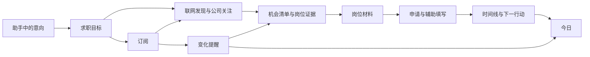
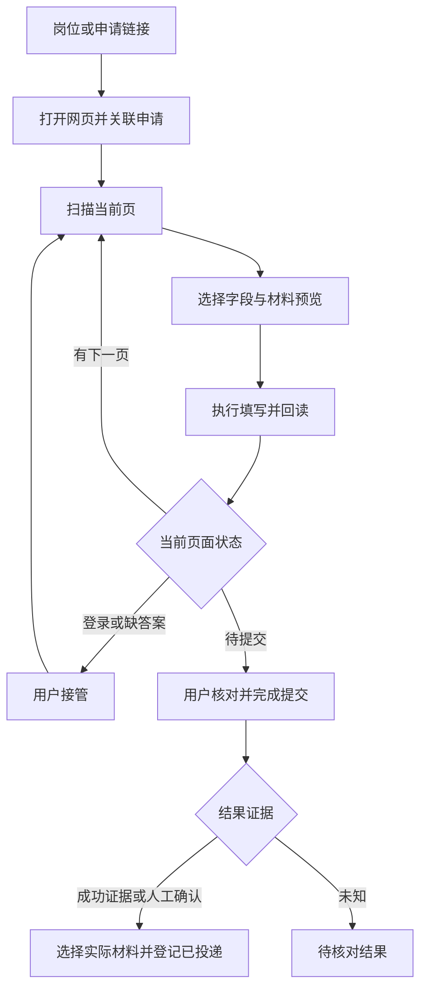

# 个人求职 Agent 交互设计

日期为 2026-11-12。本文依据 [需求分析](REQUIREMENTS.md)描述产品交互，覆盖 F1–F7。技术契约见[技术设计](TECHNICAL_PLAN.md)，视觉执行规范见[界面设计说明](UI_DESIGN_PROMPT.md)。真实使用效果待用户验证。

## 1. 设计目标与采用的假设

用户从一句求职意向开始，能找到有依据的机会，持续跟进变化，准备材料并完成可追溯的申请。首次搜索只要求方向，完整交付覆盖需求中的 P0、P1 和历史迁移，P2 连接按需启用。

本设计采用需求建议的学生求职、单用户本地运行、对话主入口、多独立目标和北京时间每日 09:00 默认检查。额外产品决策如下，均可在评审后调整。

- 首次进入直接显示助手，已有数据时默认显示今日页。
- 未配置外部通知时，订阅采用站内通知并明确显示渠道。
- 新岗订阅默认收录符合方向、无已知硬条件冲突的岗位，资格未知项随提醒展示，用户可切换为“仅资格全部明确符合”。
- “暂缓”暂时停止该岗位的新机会提醒，用户恢复后参与后续检查。“不感兴趣”停止该岗位的机会提醒，已登记的申请行动独立保留。
- 已投递岗位停止新岗提醒，明确截止、重新开放、资格变化由单独的跟进策略控制，默认关闭。
- 条件调整后的首轮结果直接展示并建立新基线，随后按新条件检查。

以上默认值在实际创建或修改结果中显示，用户可以当场编辑。示例中的 2028 届、AI 产品经理实习和江浙沪只用于验收与线框示意。

## 2. 信息架构

### 2.1 主导航与对象关系

| 入口 | 用户目的 | 一级内容 | 深入操作 |
|---|---|---|---|
| 今日 | 处理当天事项 | 接管任务、到期行动、新机会、未确认结果 | 回到原岗位、申请或运行 |
| 助手 | 说明需求、推进任务 | 会话、当前目标、工作记录、输入区 | 搜索、修改条件、创建订阅、查进度 |
| 机会 | 比较和筛选 | 目标切换、岗位列表、公司关注 | 岗位详情、资格证据、材料、申请 |
| 申请 | 跟进投递 | 申请台账、下一行动、时间线 | 新建、纠错、材料核对、继续填写 |
| 我的资料 | 维护可复用信息 | 个人事实、基础简历、版本和附件 | 事实纠错、资料删除、材料历史 |
| 设置 | 管理运行条件 | 模型、搜索、通知、来源、备份、可选连接 | 能力检测、日志、恢复和迁移报告 |

“目标与订阅”由助手顶部和机会页共同进入同一管理面板。材料详情属于岗位或申请，来源维护属于设置。各入口链接到同一个业务对象，刷新和浏览器返回保留目标、筛选及分页位置。



### 2.2 页面路径

目标路由包括 `/today`、`/assistant/:threadId?`、`/opportunities?goal=…`、`/jobs/:jobId`、`/goals/:goalId`、`/subscriptions/:id`、`/applications`、`/applications/:id`、`/applications/:id/fill`、`/materials/:id`、`/profile`、`/settings`。根路径按首次使用状态进入助手或今日。实际实现时集中定义路由与对象链接。

### 2.3 全局上下文

桌面侧栏常驻六个入口，页面标题区显示本地服务状态及需要用户处理的运行数量。助手输入框上方始终显示当前目标，进入岗位或申请时显示对象名称。每个会话保存自己的当前目标，临时切换只影响当前会话。

新目标在用户明确切换后生效。多目标且无法确定对象时，显示一次目标选择问题，选择后继续原动作。个人资料修改影响全部目标，保存结果中列出受影响目标数量。

## 3. 首次使用与对话协议

### 3.1 首次使用

首屏展示“想找什么岗位？”及输入框，允许粘贴岗位链接。输入方向后立即建立初步目标，搜索能力可用时开始检索。用一句话说明本轮条件和影响资格的缺失项，例如“正在找 AI 产品经理实习，毕业时间和到岗条件尚未提供”。搜索过程中允许继续补充条件。

模型或搜索缺失时，显示具体能力状态及“配置连接”“查看已有岗位”“导入链接”入口。手工申请和资料管理仍可进入。配置完成后保留原输入，提供继续本轮任务。简历导入在准备材料时引导。

### 3.2 对话中的操作反馈

| 用户表达 | 保存或执行 | 展示结果 |
|---|---|---|
| 帮我找 AI 产品经理实习 | 创建目标并联网搜索 | 当前条件、覆盖范围、进度和首批结果 |
| 我是 2028 届 | 保存个人毕业年份，当轮重算 | 已保存事实、受影响目标、结果变化 |
| 日常实习，主要江浙沪 | 修改当前目标类型和地域偏好 | 江苏／浙江／上海，明确显示“优先” |
| 只看江浙沪 | 将地域改为硬条件 | 已保存条件及被排除结果的入口 |
| 每天早上查，有新岗提醒 | 创建实际订阅 | 时间、时区、目标、范围、渠道、下次执行 |
| 加一些中小厂 | 扩展目标公司范围并首轮检查 | 新增公司、依据、可访问渠道及检查结果 |
| 现在查到哪里了 | 查询运行记录 | 完成来源、受限来源、已得结果，任务继续 |

明确自述直接保存，系统推断进入待确认项。冲突问题只询问冲突字段，例如“毕业年份已保存为 2028，要改为 2027 吗？”同轮其他独立搜索结果继续保留。删除事实后关联资格回到未知，历史申请材料仍展示当时使用的版本。

### 3.3 工作记录结构

助手记录按顺序包含用户原文、已保存条件、运行摘要、结果和下一动作。结果使用结构化块，保存成功块引用服务器返回的对象与版本。保存失败显示失败原因、可重试操作和用户原输入。

运行摘要默认显示当前阶段、已完成来源数和中止按钮。展开后显示工具、起止时间、来源失败和重试。离开页面后从今日页或原会话恢复查看。流式连接断开时显示“连接恢复中”，已落库内容保留。

## 4. 关键页面线框与操作

下列数据均为布局示意，实装使用真实结果。

### 4.1 助手工作台

```text
┌────────┬────────────────────────────────────┬──────────────────────┐
│ 导航   │ 会话标题                 历史会话 │ 当前目标             │
│ 今日   │ 用户  帮我找 AI 产品经理实习      │ AI 产品经理日常实习  │
│ 助手   │ 已保存目标  [编辑条件]            │ 毕业年份 2028        │
│ 机会   │ 正在检查招聘官网  [展开] [中止]   │ 地域优先 江浙沪      │
│ 申请   │ 首批岗位及待确认项                │ [目标与订阅]         │
│ 资料   │ [查看全部机会] [每天检查]         │                      │
│ 设置   │ 当前目标 …                        │ 当前任务             │
│        │ [输入补充条件或新的任务       发送]│ 受限渠道／接管事项   │
└────────┴────────────────────────────────────┴──────────────────────┘
```

会话列表通过“历史会话”展开，主区宽度优先服务结果。岗位记录、订阅结果及接管面板在窄屏纵向展开，目标入口保持在输入框上方。新内容到达时，用户正在阅读历史则显示“有新结果”，由用户跳转。

### 4.2 今日页

优先显示当前需要接管的申请、结果未知的提交，其次是到期行动、新机会和最近进展。同一对象在每个区域只占一项，点击进入原操作位置。面试预约按用户时区展示未来时间，完成后从待办移出并保留时间线。

无待办时显示“当前没有待处理事项”、最近订阅检查时间及“找新机会”。无历史数据时显示输入意向的单一启动入口。来源故障以受影响目标和操作展示，连续同一故障保留一条待处理项。

### 4.3 机会清单

```text
当前目标 [AI 产品经理实习 v3 ▼]  [修改条件] [目标与订阅] [立即搜索]
本轮检查时间 · 覆盖渠道 · 受限来源 · 仍在核验的数量
[可考虑] [资格待确认] [不符合] [想投] [暂缓] [不感兴趣]   搜索／筛选
公司／岗位       地点／类型       资格结论       推荐依据与未知项       操作
示例公司／AI PM  上海／日常实习   毕业条件符合   职责相关，天数未知     查看
[继续查看]                    已加载范围／结果总量（可计算时显示）
```

“可考虑”含无已知冲突的结果，资格未知同时有文字标记。“不符合”保留排除原因可查。默认排序先考虑方向相关性与硬条件，再参考地域偏好和个人优势，排序依据在列表说明中可展开。列表支持城市、类型、公司、核验状态、用户决定筛选，服务端对完整结果筛选分页。

本轮执行信息与历史列表分开展示。全部来源失败时显示失败结果，历史岗位继续显示原核验时间。无结果时列出已查条件、渠道和受限项，提供编辑范围或创建订阅。部分结果失败时保留成功结果，重试只处理失败来源。

### 4.4 岗位详情

```text
公司／岗位／地点／招聘类型           [原始信息] [申请入口]
核验状态 · 最近核验 · 发布时间 · 截止日期及适用范围
┌──────────────────────────────┬─────────────────────────┐
│ 为什么值得看                 │ 我的决定                │
│ 资格逐项判断与原文证据       │ [想投] [暂缓] [不感兴趣]│
│ 待确认信息 [补充资料]        │ [准备材料] [开始申请]   │
│ 公司招聘项目及岗位差异       │ 关联目标与现有申请      │
│ 多来源对照／日期异常／JD全文 │ 材料与下一行动          │
└──────────────────────────────┴─────────────────────────┘
```

资格表固定显示毕业条件、招聘类型、城市、到岗日期、每周天数和实习时长。每行包含岗位要求、个人条件、符合／不符合／未知、来源片段。年份不足以判断月份区间时直接提供补充毕业月份入口。

发布日期、刷新日期、首次发现、最近核验、明确截止分别显示，未知日期留空并说明。来源冲突展示各自原文、时间和当前采用依据，关键冲突保持待确认。公司项目要求单独展示，具体岗位存在更明确要求时给出岗位依据。官网明确关闭或已到截止时间时显示关闭状态与受影响申请，用户仍能查历史和手工登记。

### 4.5 目标与订阅

目标面板分为生效条件、关注公司、订阅记录。每个条件标明硬条件或偏好，个人事实跳转资料页编辑。关注公司显示发现原因、规模证据、渠道和上次检查，规模未知使用“规模待核实”。

订阅表单包含目标、全部关注公司／指定公司、时间与时区、事件、资格未知处理、通知渠道和已投递岗位策略。“有新岗提醒”仅勾选新匹配岗位，其他事件默认关闭。全关注范围随新公司扩展，指定名单保持显式名单，用户要求新增时同步写入名单。

创建后显示实际保存结果，示例文案为“每天 09:00（Asia/Shanghai）检查该目标，站内提醒新匹配岗位。下一次执行时间由系统计算。”外部渠道配置无效时显示具体状态，用户可采用站内订阅或修复渠道。后端创建失败保持草稿。

订阅详情始终显示上次检查、上次成功、覆盖情况、下次执行、渠道状态及最近运行。暂停后显示保存时间，停止后续通知。恢复后合并补查一次，继续原约定时刻。说明本地服务需要运行，重新启动后对漏跑周期合并检查。

增加公司和更改条件后显示首轮结果，已展示部分加入基线。新范围检查尚未完成时标记“首轮检查中”，已建立基线的范围继续监控。无变化只更新检查记录。多目标命中同一岗位时合并提醒，列出目标和匹配原因。

### 4.6 材料工作区

从岗位进入后并列显示 JD 要求、已确认事实和建议编辑区。未导入简历时支持 PDF、DOCX、Markdown、纯文本及自备材料上传。导入后先显示解析结果与原文来源，用户可逐项纠正并确认可用于申请的事实。

每条建议显示原文、建议、理由和引用事实，支持采纳、编辑、保留原文。缺少依据时显示待补充问题。预览展示最终文档，保存时生成不可变材料版本，标记基础简历、岗位 JD 版本和确认时间。下载与自备材料均可关联申请。

基础简历或 JD 更新后，旧建议显示“依据已更新，请核对”，保留历史预览和旧文件。实际投递材料可从历史版本或附件中选择，当前活动简历仅作为默认选择。

### 4.7 申请与辅助填写

申请台账采用类似多维表格的记录视图，一行对应一条申请，列包含公司、岗位、城市、申请阶段、投递日期、下一步、材料和备注。支持直接编辑单元格、彩色阶段单选、视图切换、搜索筛选、排序、字段显隐和批量修改阶段。冻结公司列，窄屏在表格区域内横向滚动。申请详情显示未确认结果。支持手工新增外部申请和 JD 暂缺记录，可后续补全岗位证据。详情包含填写会话、实际材料和事件时间线。



扫描预览按拟填写、页面已有、缺失、需授权分组。已有值默认保留，覆盖需用户选择，敏感字段逐项授权。执行完成显示成功、未填和回读失败数量，各项可定位。切换页、标签页或重启后重新扫描，复用当前申请中的答案与已完成页记录。

| 入口 | 上传与提交 | 统一交互 |
|---|---|---|
| 当前页 Chrome 扩展 | 用户在官网上传和提交 | 选择申请、预览填写、跨页继续、人工登记结果 |
| 可见浏览器执行入口 | 按实际支持提供上传或提交 | 代上传与代提交分别绑定当前申请、文件及当前页确认 |
| 完全手工 | 用户在外部完成 | 手工补记时间、阶段、材料和答案 |

接管面板说明阻塞原因、已完成内容、用户需要处理的位置及“重新扫描并继续”。暂存后在今日和申请详情可恢复。服务代提交确认必须单独显示公司、岗位、申请 URL、文件版本、当前页面和动作。页面变化后重新核对，已对当前上下文授权的动作继续复用有效授权。

填写完成、提交动作已发起、提交结果已确认分别显示。提交超时或页面无法判断时进入待核对，可打开官网核对并人工确认。恢复时先查询结果证据。相同确认的重复点击返回同一登记结果。

### 4.8 时间线与每日行动

每个事件具有阶段名称、计划／完成／取消状态、发生时间、来源和备注。支持重复面试、自定义阶段和跳级。日期修改保留修订历史，未来预约显示为下一行动，完成后才参与当前阶段计算。

新增行动时填写内容、截止时间、是否关联某阶段和提醒。完成行动只影响该行动，阶段完成由明确的事件操作记录。邮件候选存在多申请匹配或冲突时进入待核对，日历故障保留站内预约。

## 5. 跨页面状态规范

| 状态 | 用户看到的内容 | 可执行操作 |
|---|---|---|
| 排队 | 队列中及等待原因 | 取消、查看已得结果 |
| 执行中 | 当前阶段、来源覆盖、最新进度 | 查看详情、中止 |
| 等待用户 | 原因、对象、接管位置 | 补充、重新扫描、继续 |
| 部分完成 | 已成功范围和失败项 | 使用成功结果、重试失败项 |
| 完成 | 结果、实际保存对象和时间 | 进入对应任务 |
| 失败 | 失败阶段、保留内容和恢复动作 | 重试、配置连接、手工继续 |
| 已中止 | 停止位置及已生效动作 | 查看记录、启动后续任务 |
| 连接中断 | 最后已知状态与更新时间 | 重新连接，恢复事件流 |
| 结果未知 | 外部动作和证据缺口 | 核对结果、人工登记 |

加载保留已加载列表，分页失败在列表末尾重试。异步提交期间按钮显示动作进度，重复请求复用相同业务操作。错误就地展示，成功以状态更新为主。后台故障只在新增问题、问题变化或需要用户处理时通知。

## 6. 视觉、响应式与可访问性

使用浅灰画布、白色工作表面、深色正文和单一深蓝强调色。导航、列表、证据表和时间线使用连续对齐。正文采用系统中文无衬线与 Inter 回退，元数据使用 IBM Plex Mono 与系统等宽回退。字体不可用时保持可读。

桌面宽度 1280px 及以上采用约 176px 导航、弹性主区和 280–320px 可收起上下文栏。768–1279px 折叠辅助栏。小于 768px 使用顶部标题与抽屉导航、纵向记录和底部输入区，详情与审批按主流程顺序排列，资格等阅读型表格转为带标签的字段组，申请记录表保留冻结列并支持区域内横向滚动。

正文最小 14px，主要操作区域至少 44px 高，正文对比度目标 4.5∶1。状态同时使用文字与图形，所有操作提供可见键盘焦点，弹层关闭后回到触发点。新增运行结果使用温和播报，输入时保持焦点。尊重减弱动效和浏览器缩放。

## 7. 需求映射与交互验收

| 需求 | 设计位置 | 可观察验收 |
|---|---|---|
| F1.1–F1.7 | 第 2、3 节 | 空白搜索、多目标隔离、当轮保存、纠错与重启持久化 |
| F2.1–F2.8 | 第 3、4.3、4.5 节 | 未知公司发现、链接导入、部分失败和空结果 |
| F3.1–F3.11 | 第 4.3、4.4 节 | 逐项资格、日期与冲突、多来源、职能相关理由和反馈恢复 |
| F4.1–F4.13 | 第 4.5、5 节 | 实际订阅配置、基线、安静检查、暂停、补查和发送状态 |
| F5.1–F5.7 | 第 4.6 节 | 四类导入、事实确认、逐条建议、版本预览和实际材料 |
| F6.1–F6.7 | 第 4.7、5 节 | 两类填写入口、人工接管、跨页恢复和结果核对 |
| F7.1–F7.7 | 第 4.2、4.8 节 | 外部申请、重复阶段、未来预约、完整筛选和待办 |
| 需求第 9、10 节 | 第 2、5 节及技术设计迁移章节 | 数据边界、旧记录可查、来源能力、恢复与备份 |

场景 A 按需求原顺序检查保存结果、搜索覆盖、订阅回执、扩展公司和重启基线。场景 B 检查材料实际版本、每页填写结果、接管与时间线。场景 C 对全部失败、日期异常、资格未知、暂停与通知超时逐项演练。

验证时在 1440px、1024px、390px 下检查长岗位名、空数据、部分失败、运行中和接管面板，完成纯键盘主流程。用真实用户观察首次搜索、资格判断和订阅创建是否能独立完成，记录误解与耗时。

## 8. 本次交付的验证边界

本次完成文档设计和需求映射检查。线框为结构示意，页面可用性、真实搜索覆盖、模型提取准确率、外部填写和用户收益需在实现阶段验证。需求中的默认时间与本设计新增默认策略均需后续用户验证。

## 9. Muse 借鉴的后续交互候选

产品依据见[需求第 15 节](REQUIREMENTS.md#15-muse-personal-agent-能力借鉴)。以下作为现有页面的增量候选，交付顺序遵循需求第 11 节。

| 场景 | 建议交互 | 可观察结果 |
|---|---|---|
| 持续求职目标 | 目标详情聚合阶段安排、可用时间、关联申请和下一行动 | 用户能看到目标进展及每项建议的依据 |
| 阶段安排 | 对话保存“这周准备面试”等安排后显示适用目标、有效期和修改入口 | 安排在有效期内影响今日行动，到期状态可查 |
| 面试通知确认 | 用户确认通知及关联申请后，生成准备包并加入今日行动 | 可查 JD、实际提交材料、面试安排、准备清单及缺项 |
| 截止与 JD 变化 | 在现有变化记录中展示受影响材料、已准备结果及处理入口 | 用户能直接进入材料审核或继续申请 |
| 反馈学习 | 根据岗位反馈展示偏好建议、来源和影响范围，提供确认与编辑 | 用户确认后可在后续推荐中查看其实际作用 |
| 面试复盘 | 在申请详情记录真实问题、回答困难点和待补证据 | 下一次准备能引用对应记录并回看来源 |

主动通知使用简短摘要和一个直接处理入口，详情放在目标、申请或材料页面。重复后台检查沿用已有去重，值得关注的新成果和等待用户的动作进入今日及已启用渠道。

面试准备包至少显示申请、JD 版本、实际提交简历版本和生成时间，缺失关联就地提示。用户可以修正关联并重新生成，历史成果保留当时依据。
