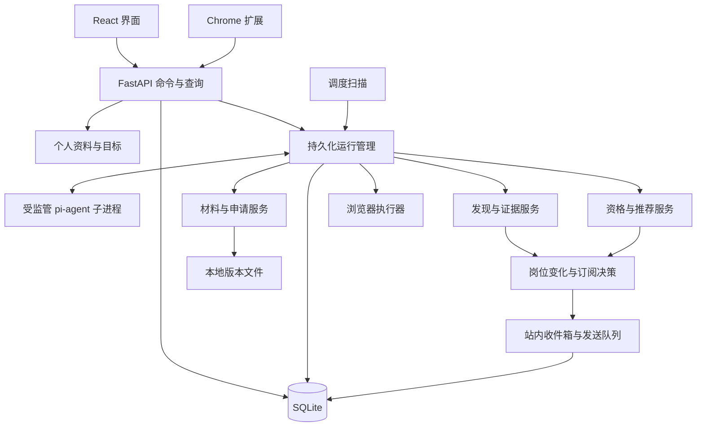
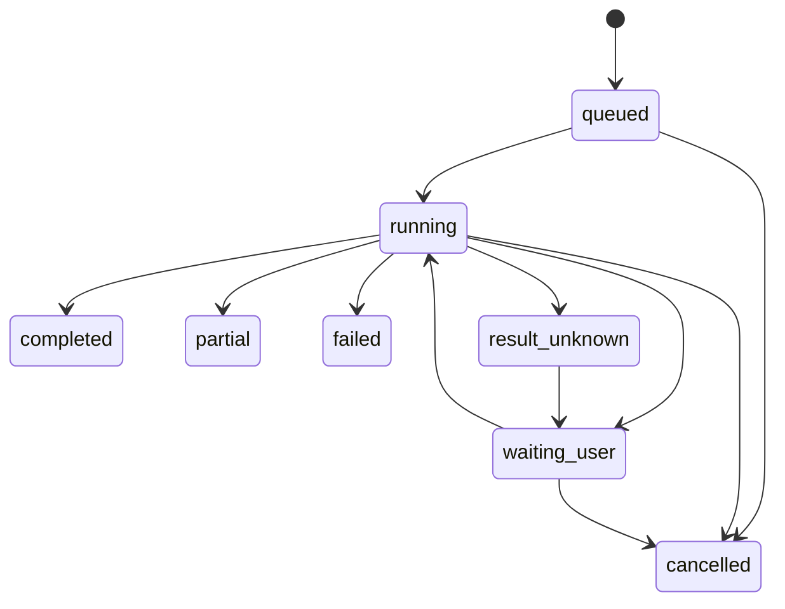

# 个人求职 Agent 技术设计

日期为 2026-11-12。本文描述系统架构、数据模型与接口约定。需求基线为 [REQUIREMENTS.md](REQUIREMENTS.md)，交互契约见[交互设计](DESIGN.md)。

## 1. 架构决策与交付范围

采用本地模块化单体。React + TypeScript 提供界面，Python FastAPI 承担业务命令、查询、事务和调度，SQLAlchemy + Alembic 管理 SQLite，文件保存在本地数据目录。Node pi-agent 子进程承担自然语言理解与工具循环，Python 持有权威状态和副作用执行权。Chrome 扩展负责用户当前页填写，可见 Playwright 执行器支持兼容流程与测试。部署延续单用户本地服务。

这些选型保留已有依赖，业务模块与数据职责按本方案重新划分。实现阶段验证锁定版本及实际能力。搜索通过应用自有接口接入一个可配置的 Web 搜索服务，具体供应商配置属于部署选项，尚需真实只读搜索验收。

核心交付包括七项任务与迁移。邮件、日历和统计通过独立连接服务接入，连接故障在各自状态中呈现。当前数据中的关联必须可迁移和回看。

### 1.1 模块所有权

| 模块 | 拥有的数据与规则 | 调用边界 |
|---|---|---|
| profile | 个人事实、来源、确认与修订 | 目标和材料读取有效事实 |
| goals | 独立目标、条件、当前会话目标、公司名单 | 明确对象的增改命令 |
| discovery | 查询计划、公司、渠道、岗位证据与规范化 | 搜索和来源适配器返回统一结果 |
| matching | 资格判断、排序与目标级用户决定 | 读取事实、目标和岗位版本 |
| monitoring | 订阅、检查范围、基线、变化和通知决策 | 调度和发送共用同一决策 |
| materials | 简历、确认事实引用、建议、材料版本和答案 | 通过申请关联实际使用版本 |
| applications | 申请、时间线、行动和提交结果 | 阶段投影由事件计算 |
| execution | Run、Step、Event、授权与恢复 | 所有入口共用执行协议 |
| connections | 模型、搜索、外部通知、邮件和日历 | 状态、能力、错误与凭据管理 |

前端、聊天工具和调度调用相同应用服务。业务服务持有事务边界，来源适配器负责采集和解析，模型输出通过类型校验和证据校验后进入领域服务。

## 2. 数据模型与约束

采用整数主键、UTC 时间、显式外键和版本字段。用户输入日期保留原始文本、解析精度与原时区。枚举采用可序列化字符串，未知字段使用空值与原因。下面列出逻辑实体，实施可在保持职责和查询约束的前提下复用现有表。

### 2.1 用户上下文

| 实体 | 关键字段 | 约束与生命周期 |
|---|---|---|
| Profile | id、revision、active_resume_id | 单用户一份 |
| ProfileFact | key、value、precision、source_ref、confirmed、revision、supersedes_id | 同一事实键只有一个有效版本，经历按条目键区分 |
| Goal | name、direction、recruitment_type、constraints、preferences、revision、archived_at | 方向必填，其他允许未知 |
| GoalCompany | goal_id、company_id、reason、active、revision | 目标与公司唯一关联 |
| Thread | active_goal_id、summary_watermark | 当前目标属于会话 |
| Memory | kind、text、source_ref、active | 摘要和历史检索引用权威事实版本 |

Goal 条件按字段记录 operator、value、strength、source_ref。地域解析将江浙沪展开为江苏、浙江、上海并支持省市包含关系。“主要”写 preference，“只看”写 hard。毕业年份与毕业月份分别存储，年份精度不会自动补成六月。明确自述使用资料命令直接保存，模型推断保留候选状态。

资料和目标更新采用 expected_revision 乐观并发校验，冲突返回最新版本。一次命令内完成事实修改、版本递增、受影响资格失效和事件记录。查询发现旧匹配版本时返回“重算中”与已保存条件。删除事实同时更新摘要检索投影，历史版本材料保留当时的依据。

### 2.2 公司、岗位与证据

| 实体 | 关键字段 | 约束与用途 |
|---|---|---|
| Company | name、aliases、official_domains、size、size_evidence | 公司身份和规模依据 |
| Source | company_id、type、url、access_state、adapter_key | 官网、平台、社区和可访问入口 |
| SearchBatch | goal_id、goal_revision、profile_revision、query_plan、scope、run_id | 一轮发现的覆盖与结果 |
| SourceCheck | batch_id、source_id、status、started_at、finished_at、counts、error | 每个来源独立记录成功或受限 |
| Job | company_id、title、department、locations、application_url、status、revision | 跨来源规范岗位 |
| JobSource | job_id、source_id、external_id、url、first_seen_at、last_checked_at | source_id + external_id 唯一，缺编号时采用规范 URL |
| JobEvidence | job_source_id、observed_at、raw_text、fields、date_precision、parser_version | 保存观察版本与字段原文片段 |
| RecruitmentProgram | company_id、name、requirements、evidence_ref | 公司项目与具体岗位关联 |
| Match | job_id、goal_id、profile_revision、goal_revision、job_revision、rules_version、assessment | 按版本缓存逐项资格及排序 |
| JobDecision | job_id、goal_id、value、reason、revision | 目标内想投／暂缓／不感兴趣／未决定 |

Job 至少具有公司、标题、招聘内容、来源链接和核验时间。缺少完整内容的搜索命中保存在候选结果中，界面说明待核验。发布日期、刷新日期、首次发现、核验日期、截止时间及其范围分别保存。证据保存原文与访问时间，动态页面可按需要保留页面快照。

多个目标共享岗位事实，各自拥有匹配与用户决定。某目标忽略岗位后，其他目标仍可独立推荐，提醒合并时排除已忽略的目标。

### 2.3 订阅与通知

| 实体 | 关键字段 | 关键唯一约束 |
|---|---|---|
| Subscription | goal_id、scope_mode、company_ids、schedule_kind、schedule_value、timezone、event_policy、channels、enabled、revision、next_run_at | 每条显式配置独立存在 |
| SubscriptionCheck | subscription_id、occurrence_key、scope_revision、run_id、status、last_success_at | subscription_id + occurrence_key |
| SubscriptionJobState | subscription_id、job_id、first_observed_revision、baseline_reason、last_evaluated_revision | subscription_id + job_id |
| JobEvent | job_id、kind、transition_revision、evidence_refs、created_at | job_id + kind + transition_revision |
| NotificationIntent | job_event_id、subscription_id、goal_revision、status、reason | job_event_id + subscription_id |
| InboxItem | event_key、goal_reasons、created_at、seen_at | 单用户 event_key 唯一 |
| Delivery | inbox_id、channel、status、attempts、last_error、next_attempt_at | inbox_id + channel 唯一 |

新增字段的 JSON 用于结构化条件和证据。调度时间、对象关联、状态和去重键使用可索引字段。InboxItem 的 event_key 对应规范岗位的一次业务变化，多个订阅合并为目标原因列表。Delivery 支持 pending、sending、accepted、failed、unknown、cancelled。渠道接受状态与用户实际阅读状态分别保存。

### 2.4 材料、申请与运行

保留基础简历文档、附件、逐项事实、建议、不可变材料版本和申请答案。MaterialVersion 保存基础简历版本、JD 版本、采纳内容、文件引用及创建时间。ApplicationMaterialUsage 保存实际投递所用文件和答案快照。

Application 可关联规范 Job，也允许岗位事实未补齐的手工记录，至少提供公司和岗位名。ApplicationProgressEvent 支持稳定事件 ID、sequence、stage_label、state、planned_at、occurred_at、source_ref 和修订历史。ActionItem 保存下一行动、到期时间及完成状态。

ExecutionRun 是用户任务的唯一进度入口，字段包含 kind、origin、thread_id、goal_id、application_id、status、context_versions、result、error、checkpoint、cancellation_requested。Step 保存工具、参数、业务操作键、结果与状态，Event 保存单调递增 ID 和用户可读进度。底层来源检查、填写会话引用 run_id。

FillSession 保存 application_id、executor、page_history 和 checkpoint。FormSnapshot 保存页面 URL、字段结构、已有值状态和检查时间。授权记录绑定申请、动作、页面快照、字段或文件版本及消费状态。运行数据与申请进展分开持久化。

## 3. 对话与业务命令

### 3.1 处理顺序

1. 接收消息，保存原文、显式对象与操作 ID。
2. 构造当前会话目标、有效个人事实和相关历史上下文。
3. pi-agent 调用类型化领域工具，Python 校验对象、参数与当前版本。
4. 明确资料修改先完成持久化，再以新版本启动或调整搜索与资格判断。
5. 搜索与准备任务写入 Run，工具立即返回 run_id 或已保存对象。
6. 回答根据工具真实返回值生成，前端渲染保存回执和运行结果。

同一轮有个人事实和目标修改时，使用一个上下文命令统一提交。跨会话事实修改触发所有目标重算，目标修改仅影响该目标。运行保存开始时版本，结果返回时检测版本变化并复核，旧结果说明原条件。

### 3.2 工具集合

| 工具 | 参数摘要 | 返回或动作 |
|---|---|---|
| update_context | profile_patch、goal_id／new_goal、goal_patch、expected_revisions | 实际保存版本、条件与影响范围 |
| list_goals | archived | 目标列表及当前上下文 |
| search_jobs | goal_id、query、filters、cursor | 已有岗位检索及检索范围 |
| discover_jobs | goal_id、mode、urls、company_scope | 联网发现 run_id、计划与覆盖 |
| expand_companies | goal_id、criteria、subscription_ids | 公司发现和名单更新后的首轮检查 |
| get_job_assessment | job_id、goal_id | 逐项资格、证据及理由 |
| set_job_decision | job_id、goal_id、decision | 保存反馈并影响排序及提醒 |
| manage_subscription | action、id、expected_revision、config | 实际配置或立即检查 run_id |
| get_progress | run_id／subscription_id | 持久化进度与渠道状态 |
| prepare_materials | job_id、resume_id | 事实核对与材料准备运行 |
| start_fill | application_id、url、executor | 扫描与预览 |
| manage_application | action、application_id、event／action_item | 申请、时间线与行动 |
| query_workspace | resource、filters、cursor | 申请、待办、来源或资料查询 |

最终提交由绑定申请的授权接口进入执行器。执行器校验当前授权和页面，pi-agent 只读取审批状态。聊天中的明确操作授权可以在相同对象与有效上下文内复用，确认页面变化、文件变化或动作扩大时重新取得对应确认。

## 4. 联网发现与证据处理

### 4.1 发现流水线

查询计划从方向、招聘类型、地域和公司范围产生，分别覆盖已知来源、未知公司搜索和用户导入链接。候选链接按官网、平台和社区分类，获取可访问详情后提取结构化信息，关联公司与规范岗位，再做资格判断和排序。首次结果可分批返回，剩余来源继续执行。

搜索适配器统一提供 query、region、cursor 输入，返回 hits、next_cursor、provider、checked_at、limitations。来源适配器提供 discover 和 fetch_detail，返回原文、字段证据和访问状态。页面内容作为数据传递，执行工具与凭据由后端控制。

查询日志保存主要关键词与来源覆盖，搜索请求只携带岗位意向等必要信息。简历和联系方式进入模型与网页前显示数据用途，日志中屏蔽密钥、凭据及完整敏感答案。

### 4.2 去重与身份

按以下证据顺序关联岗位。

1. 同公司、同招聘系统岗位编号精确关联。
2. 已明确的一对一申请 URL 或详情 URL 关联，移除追踪参数并保留岗位参数。
3. 公司、标题、地点、团队及招聘内容一致时建立可解释的关联候选。

不同编号、地点或团队存在实质差异时保留独立岗位。共享列表 URL 与文本相似只作为辅助信号。证据不足时保留分离和待核对状态。人工合并时在事务中迁移目标决定、申请关联、基线及提醒键，合并后的重复提醒记录保留历史并停止发送。

### 4.3 来源冲突与状态

字段优先采用可访问的官方岗位最新明确证据，同时记录其他来源。官方公司项目只有项目级适用范围，具体岗位规则单独判断。关键条件互相冲突且无法消解时设为 unknown，展示来源差异。来源日期晚于访问时刻等异常保留原文并标记。

确认关闭或明确截止已过将 Job 更新为 closed，关闭证据进入事件。抓取失败、列表缺失、登录受限和详情不可达更新来源访问状态及新鲜度，开放状态置为待核验或保留带时间的旧观察。每个来源独立提交成功结果，批次汇总为 completed、partial 或 failed。全部失败时保留历史核验时间。

## 5. 资格与排序

资格输出为每个维度的 requirement、candidate_value、result、reason、evidence_refs。result 采用 pass／fail／unknown。已知硬条件冲突进入不符合列表，其余有 unknown 时进入可考虑且待确认。匹配缓存键包含个人资料、目标、岗位和规则版本。

| 维度 | 判定方法 |
|---|---|
| 毕业条件 | 区分年份集合、年份上下界、日期闭区间和在校身份；个人日期精度不足返回未知 |
| 招聘类型 | 日常、暑期、应届项目分别解析；岗位文本未说明则未知 |
| 城市 | 省市层级、远程和硬条件分别比较；地域偏好影响排序 |
| 到岗日期 | 比较个人可到岗范围与岗位明确时间要求 |
| 每周天数 | 个人可提供天数与岗位最低天数比较 |
| 时长 | 明确月数／周数及起止范围分别存储；无法可靠换算返回未知 |

“2026 届及以后”与“2028 届”年份关系通过，其他条件继续判断。全体在校生要求用在校事实判断。模型只提取候选要求和引用，确定性代码验证日期、比较条件并生成资格结论。

排序以目标方向职责相关性、偏好、确认优势为主要输入。方向策略提供职能相关职责词和评价维度，AI 产品使用需求分析、产品设计、AI 应用理解等维度，技能未知保持未知。向量和 LLM 可作为可选排序增强，缺失时确定性排序仍能运行。排序及模型变动只更新推荐记录。

## 6. 订阅、基线与通知

### 6.1 创建及范围初始化

创建订阅时，在一个事务中保存配置、revision、下次时间，并把该目标已向用户展示的规范岗位写入 SubscriptionJobState。展示回执由客户端按已渲染岗位 ID 上报，服务端校验这些岗位属于相应搜索结果。消息结果包含的岗位同样写入展示记录。

为避免离线页面造成历史重发，创建订阅后执行一次范围初始化检查。首轮结果进入站内可查的运行报告，结果与基线原子保存，标记 baseline_reason=initial_check。首轮只收集基线，后续新出现的匹配岗位进入新岗事件。即使用户尚未打开首轮报告，仍可从报告查看全部结果。

增加公司和更改目标条件使用新的范围版本，受影响范围先做首轮检查并展示，再纳入基线。首轮部分失败时，成功来源基线已生效，失败来源保留待初始化状态，首次成功检查仍采用初始化规则。每个来源的范围状态记录在 SubscriptionCheck 的覆盖明细中。

### 6.2 业务事件与决策

Job 的真实事实变化生成 JobEvent，包括 first_observed、reopened、qualification_changed、deadline_due。new_match 的提醒候选由岗位首次观察与订阅范围资格评估共同产生。同一岗位第一次进入订阅时，已有基线则记录观察，后续重采、换源或重排复用同一个岗位身份。

发送决策按顺序执行。

1. 检查订阅启用、事件类型、当前公司范围与初始化状态。
2. 按最新目标和资料重算资格，应用未知处理策略。
3. 检查该目标的暂缓、不感兴趣及已投递策略。
4. 检查 SubscriptionJobState 与已存在的 NotificationIntent。
5. 在同一事务中写入意图、合并站内 InboxItem 及渠道 Delivery。

同一事件命中多个目标时，InboxItem 聚合原因列表，渠道投递复用相同 event_key。同一事件后续新增目标原因更新站内记录，已接受的外部投递保持一条。发送前重新汇总仍有效的订阅原因，某订阅暂停时移除其原因，其他有效目标仍按各自约定处理。新岗身份与推荐分数版本独立。

### 6.3 暂停、修改与发送竞态

后台检查固定自己的输入版本，入队与发送前分别读取最新配置、用户决定和岗位状态。版本失效时重新评估或取消意图。暂停接口与通知 worker 在同一进程中按订阅锁串行处理发送临界区，暂停返回后尚未开始的发送全部取消。已经发到渠道的请求及未知结果在暂停回执中列出。

外部网络调用在短数据库事务之外执行。发送前先持久化 sending 和尝试 ID，再发请求，完成后保存响应。进程在 sending 期间退出则恢复为 unknown。站内结果在外部渠道失败时仍可查。

### 6.4 重试与送达语义

明确发送失败可退避重试，重试前重走最新条件校验。网络超时与渠道响应丢失记录 unknown，展示“渠道是否收到尚未确认”。支持幂等键的渠道复用同一投递键，支持结果查询的渠道先核对。其余渠道保留人工“重试发送”入口，并说明可能重复。站内已读时间与渠道接受时间分别记录。

连续同类来源故障以 source_id + error_kind 聚合为一项待处理问题，恢复后关闭，再次发生建立新周期。无符合事件只更新检查记录。

### 6.5 调度与关机补查

新订阅支持 daily_local_time + IANA timezone，默认 Asia/Shanghai 09:00。内部 next_run_at 转为 UTC。时区涉及夏令时的日期按时区库计算，缺失时刻移到当日首个有效时刻，重复时刻只执行一次，回执展示实际执行时间。

APScheduler 只负责周期扫描，数据库保存约定与执行水位。单进程事务领取到期订阅，以 subscription_id + occurrence_key 防重复，检查运行完成后回写覆盖和成功时间。目标相同的并发请求可以共享采集批次，各订阅独立做基线与事件决策。

启动时读取漏跑订阅，合并为一次补查并保留漏跑区间，再将 next_run_at 推进到未来的原约定时刻。失败在本次运行内有限重试，持续失败记录待处理项，后续仍按约定检查。旧 interval 任务保留 interval_minutes 和原时间锚点，用户修改时再转换时间模式。

## 7. 运行、并发与恢复

### 7.1 执行状态

Run 使用 queued、running、waiting_user、completed、partial、failed、cancelled、result_unknown。当前业务阶段独立存 phase，例如 collecting、assessing、fill_preview、awaiting_submit_confirmation。UI 从 status、phase 和 action_required 渲染用户语言。

Run 的所有转换追加 Event。步骤操作键绑定 run、步骤和领域对象，重试复用已完成结果。外部动作执行前写入动作意图，结果未知进入核对路径。恢复先查持久化状态，已完成步骤跳过，浏览器步骤要求重新扫描。纯文本会话流结束以运行最终落库状态为准。

### 7.2 并发边界

FastAPI 使用单个业务 worker。浏览器变更动作按会话互斥，同一申请的写操作串行。来源读取可有限并发且受连接预算控制，模型对话串行使用 Node 运行时。后台确定性采集不占用对话模型会话。资料查看和目标更新可在任务期间继续进行。

数据库事务保持短小，网络和模型调用使用已提交输入快照。取消后禁止启动下一步，已经完成的本地保存和外部副作用保留记录。Node 退出导致当前推理步骤失败，可从持久化检查点发起后续轮次。

### 7.3 SSE

沿用持久化事件流，每条事件包含 id、run_id、type、occurred_at、payload。客户端使用 Last-Event-ID 续接并按 ID 去重，先查询当前 Run 再接流。事件至少包含 context_saved、progress、result_batch、action_required、run_finished 和 delivery_updated。连接丢失后轮询 Run 作为回退，任务在后台继续执行。

## 8. 材料、填写与申请一致性

### 8.1 资料和材料

四类简历导入输出原文、事实候选与来源定位。用户确认后事实可用于答案和建议。每条建议保存事实引用、JD 版本、用户决定和编辑结果。预览与下载从同一个材料版本生成，文件先写临时路径，成功后原子移动并提交文件记录，失败清理临时文件。

资料和 JD 变动使旧建议标记待复核。已保存版本和实际投递记录保留，切换活动简历更新后续默认选择。缺少事实的申请问题转为待补充项，答案保留作用域与来源。

### 8.2 共用填写协议

扩展与 Playwright 共用 snapshot、preview、execute、verify、pause、resume、record_submission 服务。执行器声明 upload／submit／visible_browser 能力，UI 据此提供动作。扩展使用用户当前页面权限，提交由用户在官网执行。

FormSnapshot 描述字段键、标签、类型、选项、必填、已有值状态和页面结构。预览引用确认事实和答案版本，字段执行后回读。已有值默认跳过，覆盖和敏感字段授权在预览中逐项记录。页面变化时重新扫描，复用仍适用的答案及授权。

系统代提交需要一次性授权，绑定 application_id、snapshot_id、URL、岗位、文件版本和提交动作。授权消费以事务比较更新保证唯一，实际点击前复核页面。提交结果通过明确成功证据或用户确认记录。点击超时、进程重启或结果丢失保留 result_unknown，恢复先核对。

### 8.3 时间线投影

当前阶段由有效且已完成的进展事件按业务 sequence 计算，重复阶段有独立 ID。未来预约进入下一行动。日期纠错追加修订并重算投影，保留来源及原值。填写步骤完成仅更新 FillSession。提交确认命令一次写入提交结果、实际材料关联、申请进展和待办更新，重复请求复用业务操作 ID。

## 9. API 契约与前端数据流

目标 API 前缀为 `/api`。现有实现接口在切换阶段映射到新应用服务，具体退役顺序见迁移章节。

| 方法与路径 | 输入核心内容 | 返回 |
|---|---|---|
| GET /workspace | 当前日期与时区 | 待办、新机会、未确认结果、运行状态 |
| GET/PATCH /profile | expected_revision、事实修改 | 有效事实与影响目标 |
| GET/POST /goals | 条件及偏好 | 目标与 revision |
| PATCH /goals/{id} | expected_revision、patch | 生效条件、重算 run_id |
| POST /threads/{id}/messages | content、goal_id、operation_id | message_id、run_id |
| POST /discoveries | goal_id、mode、urls、scope | 202、run_id、覆盖计划 |
| GET /jobs | goal_id、filters、cursor、sort | items、next_cursor、版本与覆盖信息 |
| GET /jobs/{id} | goal_id | 岗位、证据、资格、材料与申请关联 |
| PUT /jobs/{id}/decision | goal_id、decision、operation_id | 实际决定与 revision |
| POST /result-exposures | batch_id、job_ids | 已记录展示集合 |
| GET/POST /subscriptions | 目标、范围、时间、事件、渠道 | 实际配置、下次时间、初始化运行 |
| PATCH /subscriptions/{id} | expected_revision、patch | 配置、取消投递及在途状态 |
| POST /subscriptions/{id}/checks | operation_id | run_id |
| GET /subscriptions/{id}/history | cursor | 检查、事件和发送状态 |
| POST /resumes/import | 文件或文本 | 文档、候选事实与处理运行 |
| POST /jobs/{id}/materials | resume_id、operation_id | 材料工作区与建议运行 |
| PATCH /materials/{id}/suggestions/{sid} | decision、edited_text、expected_revision | 建议与预览状态 |
| POST /materials/{id}/versions | expected_revision、operation_id | 固定版本与下载 URL |
| GET/POST /applications | filters／手工申请 | 分页记录／申请 |
| POST /applications/{id}/events | 事件与 operation_id | 事件及当前阶段 |
| PATCH /applications/{id}/events/{eid} | 日期或状态、expected_revision | 修订与重算投影 |
| GET/POST /actions | filters／行动 | 待办／行动 |
| PATCH /actions/{id} | expected_revision、状态与时间 | 更新后的行动 |
| POST /applications/{id}/fill-sessions | executor、url | 会话和能力 |
| POST /fill-sessions/{id}/snapshots | 页面结构 | snapshot_id、预览 |
| POST /fill-sessions/{id}/execute | snapshot_id、选择及授权 | run_id |
| POST /approvals/{id}/decision | decision、operation_id | 授权状态和执行结果 |
| POST /applications/{id}/submission-confirmations | 结果、时间、材料版本、operation_id | 申请与时间线 |
| GET /runs/{id} 及 /runs/{id}/events | 状态查询／事件游标 | Run／SSE |
| POST /runs/{id}/resume 或 /cancel | operation_id、补充内容 | Run |

创建和外部副作用命令接受 operation_id，在命令边界保存请求与结果，重复调用返回原结果，相同 ID 对应不同输入返回冲突。PATCH 使用 expected_revision，冲突返回 409 和最新对象，前端保留编辑草稿。参数错误返回 422、字段路径和修正建议，能力不可用返回结构化错误及可用操作。

统一错误字段为 code、message、field_errors、retryable、run_id。分页覆盖完整记录，排序增加稳定 ID 作为同分序，游标绑定筛选和版本。筛选变化重置游标，已加载结果在请求失败时保留。

材料服务另外提供附件上传、版本预览和下载接口，文件访问通过受控文件 ID 定位。连接服务提供能力状态、配置和检测，备份服务提供数据库与文件的一致快照及恢复报告。个人资料支持字段删除，资料与会话删除后清理相关检索投影，用户可查看历史材料及备份仍保留的数据范围。凭据沿用本地配置管理，业务工具返回脱敏状态。

React Query 缓存键含资源 ID、goal_id 和有效筛选。资料或目标保存后使匹配查询失效，订阅更新使配置与运行查询失效。可见保存结果以服务器返回值为准。SSE 只更新关联资源，事件最终状态触发查询校准。

## 10. 历史数据迁移与切换

### 10.1 映射规则

| 旧数据 | 目标归属 | 处理规则 |
|---|---|---|
| CandidateProfile | Profile、ProfileFact、Goal | 个人毕业条件与目标偏好拆分，旧 confirmed 保留，默认值无证据时待确认 |
| MemoryItem、MemoryCandidate、摘要 | Memory 和事实候选 | 保留来源、确认状态，冲突形成待核对项 |
| AgentThread、Message、上下文 | Thread、消息和水位 | 保留原 ID 或映射，当前目标无法确定时待选择 |
| JobPosting 及证据 | Company、Job、JobSource、JobEvidence | 保留旧岗位标识，不确定身份保持独立 |
| Recommendation、Evidence、UserFeedback | 历史 Match、JobDecision | 旧评分标记旧规则版本，用户决定映射至迁移目标 |
| JobChange、Notification | 历史 JobEvent、InboxItem、Delivery、基线 | 保存已读／已发送状态，推荐重算保持历史已知岗位 |
| AutomationSchedule | Subscription 或保留型自动任务 | 招聘监控关联迁移目标，interval 原样保留；其他工作流保留任务配置 |
| ResumeDocument、Fact、Field、Attachment、Version | 文档、事实、附件和材料版本 | 文件原样引用，保留用户修正与活动版本 |
| Application、Answer、各事件 | 申请、答案、进展及修订 | 保留重复阶段、实际材料、日期、顺序和外部关联 |
| AgentRun、TaskRun、Step、Event、Approval | ExecutionRun 与历史记录 | 根据已有关联归并，同一用户任务一个入口，无法证明关联则独立保留 |
| FormSnapshot、扩展会话 | FillSession 与快照历史 | 未完成填写设需重新扫描，旧页面审批待核对 |
| ExternalMailEvent、CalendarEventLink、连接配置 | 可选连接与关联 | 保留外部 ID，恢复后按 ID 去重 |

目标归属无法唯一确定时建立“历史求职目标”并保留原条件，界面提示核对。迁移后现有岗位统一建立历史基线，避免集中重发。旧未知发送结果保留 unknown。原任务状态和原表 ID 留在迁移映射中，可追溯原记录。

### 10.2 执行与回退

1. 停止写入，关闭调度和发送，备份 SQLite 与完整文件目录，记录源版本和数量。
2. 在副本执行 Alembic 与数据转换，映射表记录 old_table、old_id、new_id、migration_version，迁移可重跑。
3. 核对分类数量、外键、全部材料文件可读性、实际材料关联、时间线和代表性会话。核对所有未完成任务的恢复去向及通知基线。
4. 用副本运行验收场景，调度和通知使用隔离测试渠道，真实提交由人工控制。
5. 升级前端、后端与扩展，写入目标 schema 版本，切换数据目录，再开启调度与通知。
6. 发现迁移问题时保持写入关闭，恢复备份与对应版本后重试。切换后产生的新申请和外部动作先保全并核对，再安排回退或前向修复。

全量重构采用一次正式数据切换。旧代码保留在 Git 历史，切换发布中前端和扩展统一使用目标 API，旧浏览器客户端收到需要更新的提示。历史数据在迁移验收通过后继续长期可查，原备份按用户选择保留。

## 11. 实施顺序与删除依据

| 阶段 | 交付 | 验收与切换条件 |
|---|---|---|
| 1 数据与命令基础 | 新职责模型、迁移演练、统一 Run 和上下文命令 | 副本数据可查、明确条件当轮生效 |
| 2 找岗闭环 P0 | 联网发现、资格、公司扩展、目标 UI | 场景 A 的前四步和相关 C 用例 |
| 3 监控闭环 P0 | 初始化基线、调度、通知与订阅 UI | A 全流程、重复检查、暂停与重启 |
| 4 申请闭环 P1 | 材料、填写会话、台账、时间线与今日 | B 全流程、实际材料和未知结果 |
| 5 全量切换 | 正式迁移、连接关联、旧入口退役 | 核心 A/B/C、迁移与恢复验收完成 |

用户条件统一到 Profile／Goal，记忆保留引用。任务进度统一到 ExecutionRun，底层采集保留来源检查。提醒统一使用事件决策与 Delivery。两个填写入口共用预览、授权和结果协议。申请状态由进展事件投影。

删除原实现前逐项确认原调用者、数据读取和验收行为已接入新入口，再移除旧写路径和重复投影。功能按阶段接入，完整交付以第 5 阶段为准。

## 12. 验证计划与可观测性

### 12.1 需求到技术契约

| 需求 | 主要技术章节 | 关键检查 |
|---|---|---|
| F1.1–F1.7 | 第 2.1、3、9 节 | 事实与目标归属、明确修改、当前对象和重算 |
| F2.1–F2.8 | 第 2.2、4 节 | 发现、导入、公司扩展、覆盖和部分结果 |
| F3.1–F3.11 | 第 2.2、4、5 节 | 多源身份、时间与证据、资格规则和目标决定 |
| F4.1–F4.13 | 第 2.3、6、7 节 | 基线、业务变化、暂停竞态、发送和调度 |
| F5.1–F5.7 | 第 2.4、8.1、9 节 | 导入、确认事实、逐条建议和不可变材料 |
| F6.1–F6.7 | 第 7、8.2、8.3 节 | 执行能力、预览授权、接管、恢复及结果核对 |
| F7.1–F7.7 | 第 2.4、8.3、9 节 | 手工申请、阶段事件、未来行动和完整分页 |
| 需求第 9、10 节 | 第 7、9、10 节 | 运行边界、隐私、可恢复性和数据迁移 |
| 场景 A、B、C | 第 11、12.2 节 | 分阶段验收及最终完整链路 |

### 12.2 行为验证与运行记录

| 检查 | 具体发现的问题 | 失败后的处理 |
|---|---|---|
| 上下文命令测试 | 多目标串改、事实未生效、版本冲突 | 修正事务与对象归属 |
| 搜索固定来源测试 | 未知公司遗漏、部分失败丢结果、链接导入失败 | 修正计划和适配器 |
| 资格表驱动测试 | 年份范围、月份精度、在校身份、天数和时长误判 | 修正解析或确定性比较 |
| 岗位身份测试 | 跨源重复、不同编号和团队误合并 | 修正关联证据与约束 |
| 订阅状态测试 | 基线丢失、重复提醒、范围初始化和未知资格策略不一致 | 修正原子写入与事件决策 |
| 暂停与修改竞态测试 | 使用旧条件发送、暂停后新发、同事件多目标重复 | 修正锁与发送前复核 |
| 调度时钟测试 | 重启重复补查、漂移、旧 interval 改约定 | 修正 occurrence 与时间计算 |
| 通知故障注入 | 超时误记成功、sending 崩溃后重复发送 | 修正 unknown 和渠道重试 |
| 材料版本测试 | 无依据建议、依据变更未提示、实际材料错链 | 修正事实引用与版本关联 |
| Mock ATS 与扩展测试 | 覆盖已有值、接管丢失、多页恢复、重复提交 | 修正共用填写及授权协议 |
| 时间线测试 | 未来预约变成完成、重复阶段丢失、日期纠错错投影 | 修正进展与行动投影 |
| 迁移副本测试 | 文件缺失、关联丢失、通知洪泛、任务无恢复入口 | 修正转换后重跑副本 |
| 端到端与可访问性 | 路径断裂、窄屏操作不可达、错误无恢复 | 修正对应页面 |

现有 Python、前端与 Node 测试作为回归依据，重构后围绕行为保留和调整。实现阶段运行 pytest、前端测试及生产构建、运行时测试。真实只读检索记录时间、查询、渠道与证据，真实填写由用户参与，外部提交保持对应确认。

运行日志包含 run_id、goal_id、source_id、application_id 和版本，记录阶段耗时、来源覆盖、资格未知原因及投递状态。密钥和敏感字段值脱敏。界面读取持久化记录回答进度。

用户收益按需求第 12 节测量首次结果耗时、可考虑比例、发现延迟、重复提醒、人工耗时与恢复结果。数值目标在取得基线后确定。本次完成技术设计、静态实现对照和文档一致性检查，实际供应商能力、性能与外部流程仍需实现验证。

## 13. Muse 借鉴的后续技术落点

本节对应[需求第 15 节](REQUIREMENTS.md#15-muse-personal-agent-能力借鉴)和[交互候选](DESIGN.md#9-muse-借鉴的后续交互候选)，记录候选实现方向。现有第 11 节实施顺序作为重构主线。

| 候选能力 | 复用位置 | 增量设计方向 |
|---|---|---|
| 跨任务目标推进 | Goal、ExecutionRun、Application、ActionItem | 目标汇总关联任务与成果，保存阶段安排及时间投入，相关任务完成后更新行动建议 |
| 阶段性上下文 | profile、goals 与对话上下文 | 阶段安排保存目标、起止时间、来源和状态，按当前时间读取有效安排，稳定事实继续由 ProfileFact 管理 |
| 事件触发行动 | connections、applications、monitoring、execution | 已确认面试、截止与 JD 变化触发明确准备任务，任务结果关联原事件和目标 |
| 面试准备包 | MaterialVersion、ApplicationMaterialUsage、岗位证据及文件存储 | 汇总 JD、实际提交材料、时间及准备清单，保存来源版本和缺项，用户纠正后可重新生成 |
| 偏好与复盘复用 | JobDecision.reason、Goal.preferences、申请事件 | 从用户反馈提出带来源的偏好候选，确认后更新目标版本并重算，复盘按申请保存真实记录 |
| 经验复用 | 来源解析策略修复、表单字段学习 | 复用当前策略验证和用户纠正路径，记录适用来源或字段范围及策略版本 |

### 13.1 事件到成果的最小流程

1. 邮件识别结果经用户确认，保存关联申请及计划面试事件。
2. 创建关联事件与申请的准备 Run，读取该申请的实际提交材料和 JD 依据。
3. 保存准备包和 ActionItem，结果返回来源版本、缺项及后续操作。
4. 通过已有收件箱与渠道交付结果，同一事件和准备动作重试时复用已有运行或成果，用户要求重新生成时保留新版本。

模型负责解释变化和提出行动，领域服务校验对象与依据，ExecutionRun 负责执行和恢复。后台推进遵循本地服务运行条件和已有授权协议。

### 13.2 候选实施时的验证

重点检查邮件与申请错配、引用了其他申请材料、重复事件生成多份待办、阶段安排过期后仍影响排序，以及未经确认的推断偏好生效。验收记录包含关联准确性、准备包缺项、重复通知、人工准备耗时和用户采用情况。
